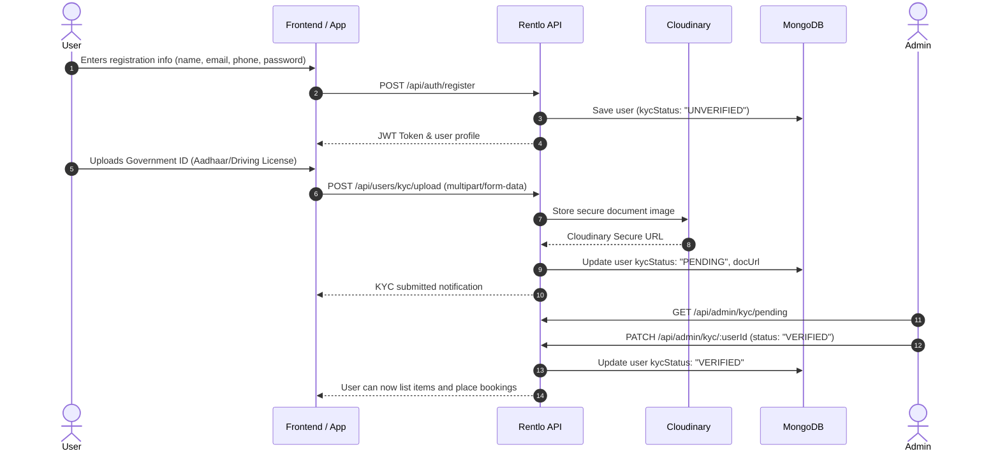
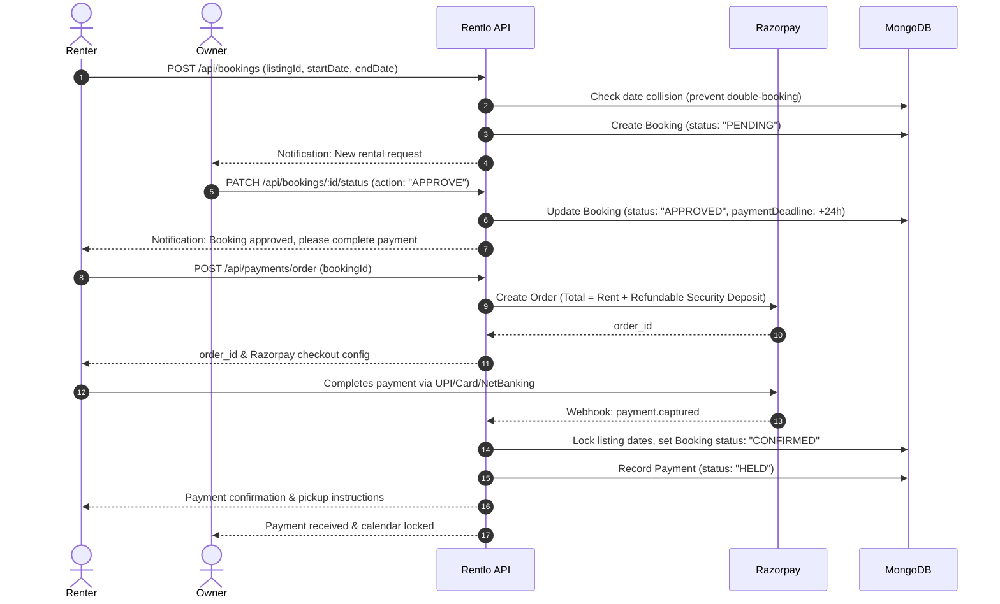
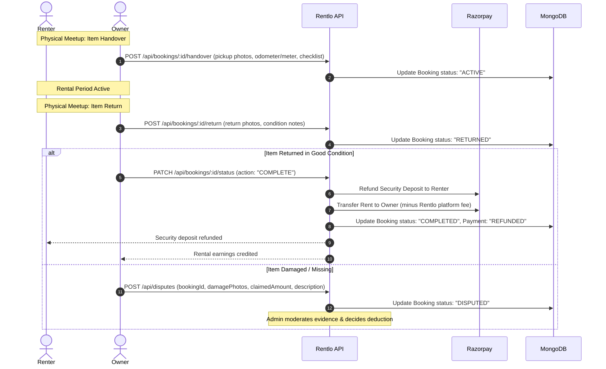

# Rentlo REST API & Workflow Documentation

**Version:** 1.0.0  
**Base URL:** `http://localhost:5000/api` (Development) / `https://api.rentlo.com/api` (Production)  
**Protocol:** HTTPS / JSON  
**Auth Scheme:** Bearer JWT (`Authorization: Bearer <token>`)

---

## 1. Overview & Conventions

Rentlo's REST API follows standard REST principles, using standard HTTP verbs (`GET`, `POST`, `PUT`, `PATCH`, `DELETE`) and standard HTTP status codes.

### Standard Response Envelopes

#### Success Response
```json
{
  "success": true,
  "statusCode": 200,
  "message": "Operation completed successfully",
  "data": { ... }
}
```

#### Error Response
```json
{
  "success": false,
  "statusCode": 400,
  "message": "Detailed error message",
  "errors": []
}
```

---

## 2. System Workflows

### 2.1 User Onboarding & KYC Verification Workflow



---

### 2.2 Booking & Escrow Payment Lifecycle



---

### 2.3 Handover, Return & Deposit Settlement Workflow



---

### 2.4 Booking State Machine

```
 [PENDING] ────(Owner Rejects / Renter Cancels)────> [CANCELLED]
     │
 (Owner Approves)
     ▼
 [APPROVED] ───(24h Payment Timeout)───────────────> [EXPIRED]
     │
 (Payment Successful)
     ▼
 [CONFIRMED]
     │
 (Item Handover Verified)
     ▼
  [ACTIVE]
     │
 (Item Returned)
     ▼
 [RETURNED] ───(Damage Reported)───────────────────> [DISPUTED]
     │                                                   │
 (Clean Return)                                     (Admin Resolution)
     ▼                                                   ▼
 [COMPLETED] <───────────────────────────────────────────┘
```

---

## 3. Detailed REST API Endpoints

### 3.1 Authentication & KYC (`/api/auth` & `/api/users`)

#### 1. Register User
* **Method:** `POST`
* **Route:** `/api/auth/register`
* **Auth Required:** No
* **Request Body:**
```json
{
  "name": "Jane Doe",
  "email": "jane@example.com",
  "phone": "+919876543210",
  "password": "Password123!",
  "role": "renter" 
}
```
* **Success Response (201 Created):**
```json
{
  "success": true,
  "statusCode": 201,
  "message": "User registered successfully",
  "data": {
    "user": {
      "id": "65f0123abcde456789",
      "name": "Jane Doe",
      "email": "jane@example.com",
      "phone": "+919876543210",
      "role": "renter",
      "kycStatus": "UNVERIFIED"
    },
    "token": "eyJhbGciOiJIUzI1NiIsInR5cCI6IkpXVCJ9..."
  }
}
```

#### 2. Login User
* **Method:** `POST`
* **Route:** `/api/auth/login`
* **Auth Required:** No
* **Request Body:**
```json
{
  "email": "jane@example.com",
  "password": "Password123!"
}
```
* **Success Response (200 OK):**
```json
{
  "success": true,
  "statusCode": 200,
  "message": "Login successful",
  "data": {
    "user": {
      "id": "65f0123abcde456789",
      "name": "Jane Doe",
      "email": "jane@example.com",
      "role": "renter",
      "kycStatus": "VERIFIED"
    },
    "token": "eyJhbGciOiJIUzI1NiIsInR5cCI6IkpXVCJ9..."
  }
}
```

#### 3. Upload KYC Document
* **Method:** `POST`
* **Route:** `/api/users/kyc/upload`
* **Auth Required:** Yes (`Bearer <token>`)
* **Content-Type:** `multipart/form-data`
* **Form Fields:**
  * `documentType`: `AADHAAR` | `DRIVING_LICENSE` | `PASSPORT`
  * `documentNumber`: `"1234-5678-9012"`
  * `file`: Image/PDF file (max 5MB)
* **Success Response (200 OK):**
```json
{
  "success": true,
  "statusCode": 200,
  "message": "KYC document submitted for verification",
  "data": {
    "kycStatus": "PENDING",
    "documentUrl": "https://res.cloudinary.com/rentlo/image/upload/v12345678/kyc/id.jpg"
  }
}
```

---

### 3.2 Listings Management (`/api/listings`)

#### 1. Search & Filter Listings
* **Method:** `GET`
* **Route:** `/api/listings`
* **Auth Required:** No
* **Query Parameters:**
  * `q`: Search keyword (e.g., `Sony A7III`)
  * `category`: `cameras` | `tools` | `camping` | `electronics` | `bikes` | `party`
  * `minPrice`: Minimum daily rental price
  * `maxPrice`: Maximum daily rental price
  * `lat`, `lng`: User geographic coordinates
  * `radius`: Search radius in kilometers (default: 15)
  * `sortBy`: `price_asc` | `price_desc` | `rating` | `distance`
  * `page`: Page number (default: 1)
  * `limit`: Items per page (default: 20)
* **Success Response (200 OK):**
```json
{
  "success": true,
  "statusCode": 200,
  "data": {
    "total": 42,
    "page": 1,
    "listings": [
      {
        "id": "65f0456defab123456",
        "title": "Sony Alpha A7 III Full-Frame Camera",
        "category": "cameras",
        "pricePerDay": 800,
        "securityDeposit": 5000,
        "images": [
          "https://res.cloudinary.com/rentlo/image/upload/v1/listings/sony_1.jpg"
        ],
        "location": {
          "address": "Koramangala 4th Block, Bengaluru",
          "coordinates": [77.6245, 12.9352]
        },
        "rating": 4.9,
        "reviewCount": 18,
        "owner": {
          "id": "65f0111ownerid",
          "name": "Arjun Kumar",
          "avatar": "https://res.cloudinary.com/rentlo/avatar.jpg"
        }
      }
    ]
  }
}
```

#### 2. Create Listing
* **Method:** `POST`
* **Route:** `/api/listings`
* **Auth Required:** Yes (`Bearer <token>`, Owner role, KYC Verified)
* **Request Body:**
```json
{
  "title": "DeWalt Cordless Drill Kit 20V",
  "description": "Includes 2 lithium-ion batteries, charger, and 30-piece drill bit set.",
  "category": "tools",
  "pricePerDay": 250,
  "securityDeposit": 1500,
  "itemValue": 8000,
  "images": [
    "https://res.cloudinary.com/rentlo/dewalt_front.jpg",
    "https://res.cloudinary.com/rentlo/dewalt_kit.jpg"
  ],
  "location": {
    "address": "Indiranagar, Bengaluru, Karnataka",
    "coordinates": [77.6412, 12.9784]
  },
  "rules": "Must return batteries fully charged. No extreme water exposure."
}
```
* **Success Response (201 Created):**
```json
{
  "success": true,
  "statusCode": 201,
  "message": "Listing published successfully",
  "data": {
    "id": "65f0789listingid",
    "status": "AVAILABLE"
  }
}
```

#### 3. Check Listing Availability
* **Method:** `GET`
* **Route:** `/api/listings/:id/availability?startDate=2026-12-01&endDate=2026-12-05`
* **Auth Required:** No
* **Success Response (200 OK):**
```json
{
  "success": true,
  "data": {
    "available": true,
    "priceCalculation": {
      "days": 4,
      "dailyRate": 250,
      "rentalFee": 1000,
      "serviceFee": 100,
      "refundableDeposit": 1500,
      "totalPayable": 2600
    }
  }
}
```

---

### 3.3 Bookings & Lifecycle (`/api/bookings`)

#### 1. Create Booking Request
* **Method:** `POST`
* **Route:** `/api/bookings`
* **Auth Required:** Yes (Renter)
* **Request Body:**
```json
{
  "listingId": "65f0789listingid",
  "startDate": "2026-12-01T10:00:00Z",
  "endDate": "2026-12-05T18:00:00Z",
  "renterNote": "Planning to use this for home renovation work over the weekend."
}
```
* **Success Response (201 Created):**
```json
{
  "success": true,
  "statusCode": 201,
  "message": "Booking request sent to owner",
  "data": {
    "bookingId": "65f0999bookid",
    "status": "PENDING",
    "totalAmount": 2600
  }
}
```

#### 2. Owner Action (Approve / Reject)
* **Method:** `PATCH`
* **Route:** `/api/bookings/:id/status`
* **Auth Required:** Yes (Owner)
* **Request Body:**
```json
{
  "action": "APPROVE" 
}
```
* **Success Response (200 OK):**
```json
{
  "success": true,
  "statusCode": 200,
  "message": "Booking approved. Awaiting renter payment.",
  "data": {
    "status": "APPROVED",
    "expiresAt": "2026-11-19T13:30:00Z"
  }
}
```

#### 3. Handover Inspection
* **Method:** `POST`
* **Route:** `/api/bookings/:id/handover`
* **Auth Required:** Yes (Owner / Renter)
* **Request Body:**
```json
{
  "photos": [
    "https://res.cloudinary.com/rentlo/handover_photo_1.jpg",
    "https://res.cloudinary.com/rentlo/handover_photo_2.jpg"
  ],
  "checklistCompleted": true,
  "notes": "Delivered with both batteries at 100% charge."
}
```
* **Success Response (200 OK):**
```json
{
  "success": true,
  "statusCode": 200,
  "message": "Handover verified. Rental is now ACTIVE.",
  "data": {
    "status": "ACTIVE"
  }
}
```

#### 4. Return Inspection
* **Method:** `POST`
* **Route:** `/api/bookings/:id/return`
* **Auth Required:** Yes (Owner)
* **Request Body:**
```json
{
  "photos": [
    "https://res.cloudinary.com/rentlo/return_photo_1.jpg"
  ],
  "condition": "EXCELLENT",
  "notes": "Item returned on time in working condition."
}
```
* **Success Response (200 OK):**
```json
{
  "success": true,
  "statusCode": 200,
  "message": "Item returned. Proceeding to deposit refund.",
  "data": {
    "status": "RETURNED"
  }
}
```

---

### 3.4 Payments & Deposit Settlement (`/api/payments`)

#### 1. Create Razorpay Payment Order
* **Method:** `POST`
* **Route:** `/api/payments/order`
* **Auth Required:** Yes (Renter)
* **Request Body:**
```json
{
  "bookingId": "65f0999bookid"
}
```
* **Success Response (200 OK):**
```json
{
  "success": true,
  "statusCode": 200,
  "data": {
    "orderId": "order_EKfMRvr20bQ22A",
    "amount": 260000,
    "currency": "INR",
    "key": "rzp_test_YourKeyID",
    "bookingDetails": {
      "rentAmount": 1000,
      "depositAmount": 1500,
      "serviceFee": 100
    }
  }
}
```

#### 2. Verify Razorpay Payment Signature
* **Method:** `POST`
* **Route:** `/api/payments/verify`
* **Auth Required:** Yes (Renter)
* **Request Body:**
```json
{
  "razorpay_order_id": "order_EKfMRvr20bQ22A",
  "razorpay_payment_id": "pay_29QQoUBi66xm2f",
  "razorpay_signature": "9ef4b61093d35988820e63c82f0b0b68..."
}
```
* **Success Response (200 OK):**
```json
{
  "success": true,
  "statusCode": 200,
  "message": "Payment verified. Booking is CONFIRMED.",
  "data": {
    "bookingStatus": "CONFIRMED",
    "paymentStatus": "HELD"
  }
}
```

#### 3. Razorpay Webhook Receiver
* **Method:** `POST`
* **Route:** `/api/payments/webhook`
* **Auth Required:** Signature validation via `x-razorpay-signature` header
* **Payload:** Standard Razorpay Webhook Event (`payment.captured`, `refund.processed`, `payment.failed`)

---

### 3.5 Disputes & Claims (`/api/disputes`)

#### 1. Raise Damage Dispute
* **Method:** `POST`
* **Route:** `/api/disputes`
* **Auth Required:** Yes (Owner)
* **Request Body:**
```json
{
  "bookingId": "65f0999bookid",
  "reason": "ITEM_DAMAGED",
  "description": "Drill chuck cracked and one battery missing from the set.",
  "claimedDeduction": 1200,
  "evidencePhotos": [
    "https://res.cloudinary.com/rentlo/damage_crack.jpg",
    "https://res.cloudinary.com/rentlo/box_missing_item.jpg"
  ]
}
```
* **Success Response (201 Created):**
```json
{
  "success": true,
  "statusCode": 201,
  "message": "Dispute ticket raised. Admin review pending.",
  "data": {
    "disputeId": "65f0disp123",
    "status": "UNDER_REVIEW"
  }
}
```

#### 2. Admin Resolve Dispute
* **Method:** `PATCH`
* **Route:** `/api/disputes/:id/resolve`
* **Auth Required:** Yes (Admin only)
* **Request Body:**
```json
{
  "approvedDeduction": 1000,
  "adminResolutionNotes": "Handover vs return photos verify cracked chuck. Rs. 1000 awarded to owner, Rs. 500 refunded to renter.",
  "penaltyParty": "RENTER"
}
```
* **Success Response (200 OK):**
```json
{
  "success": true,
  "statusCode": 200,
  "message": "Dispute resolved and funds disbursed.",
  "data": {
    "ownerPayout": 2000,
    "renterRefund": 500,
    "disputeStatus": "RESOLVED"
  }
}
```

---

### 3.6 Reviews & Ratings (`/api/reviews`)

#### 1. Submit Review
* **Method:** `POST`
* **Route:** `/api/reviews`
* **Auth Required:** Yes (Party of completed booking)
* **Request Body:**
```json
{
  "bookingId": "65f0999bookid",
  "targetType": "LISTING", 
  "targetId": "65f0789listingid",
  "rating": 5,
  "comment": "The drill worked like brand new. Super smooth communication with Arjun!"
}
```
* **Success Response (201 Created):**
```json
{
  "success": true,
  "statusCode": 201,
  "message": "Review submitted successfully"
}
```

---

## 4. HTTP Status Code Conventions

| Status Code | Meaning | Context |
| :--- | :--- | :--- |
| `200 OK` | Success | Standard successful GET, PUT, or PATCH operation. |
| `201 Created` | Created | Resource successfully created (registration, booking, listing, review). |
| `400 Bad Request` | Client Error | Missing required fields, invalid parameters, or validation failure. |
| `401 Unauthorized` | Auth Error | Missing or invalid Bearer token. |
| `403 Forbidden` | Access Denied | Authenticated user lacks permission (e.g. non-admin accessing admin route, unverified KYC). |
| `404 Not Found` | Resource Missing | Listing, Booking, or User ID does not exist. |
| `409 Conflict` | Date Collision | Item is already booked for the selected date range. |
| `500 Internal Error` | Server Failure | Unexpected server error or database disconnect. |
